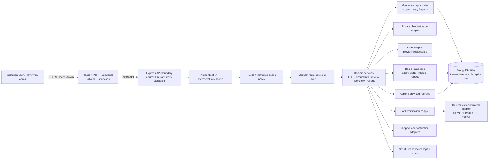
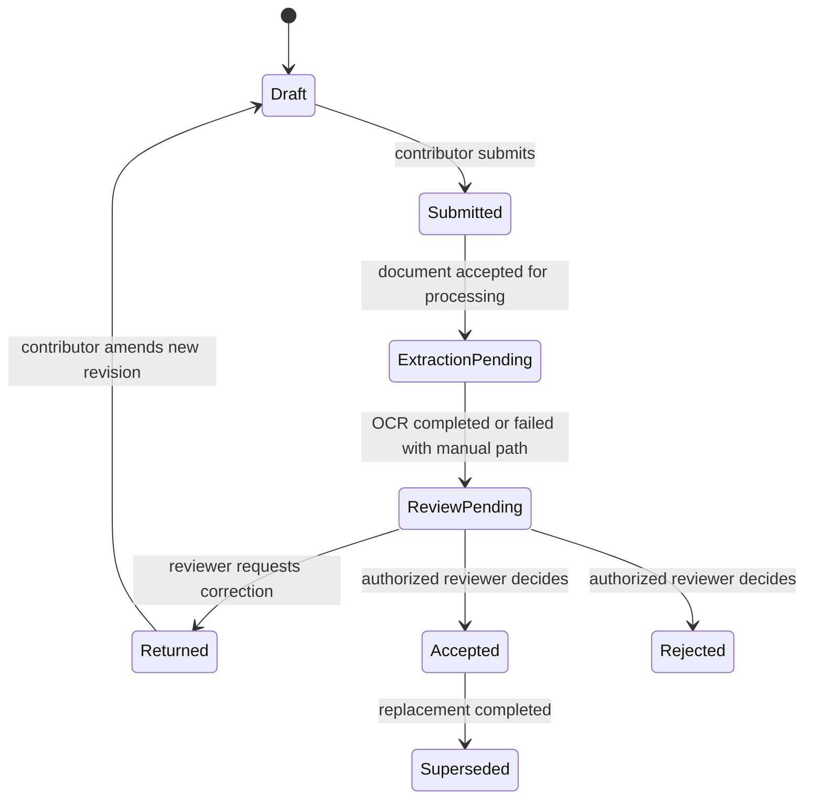
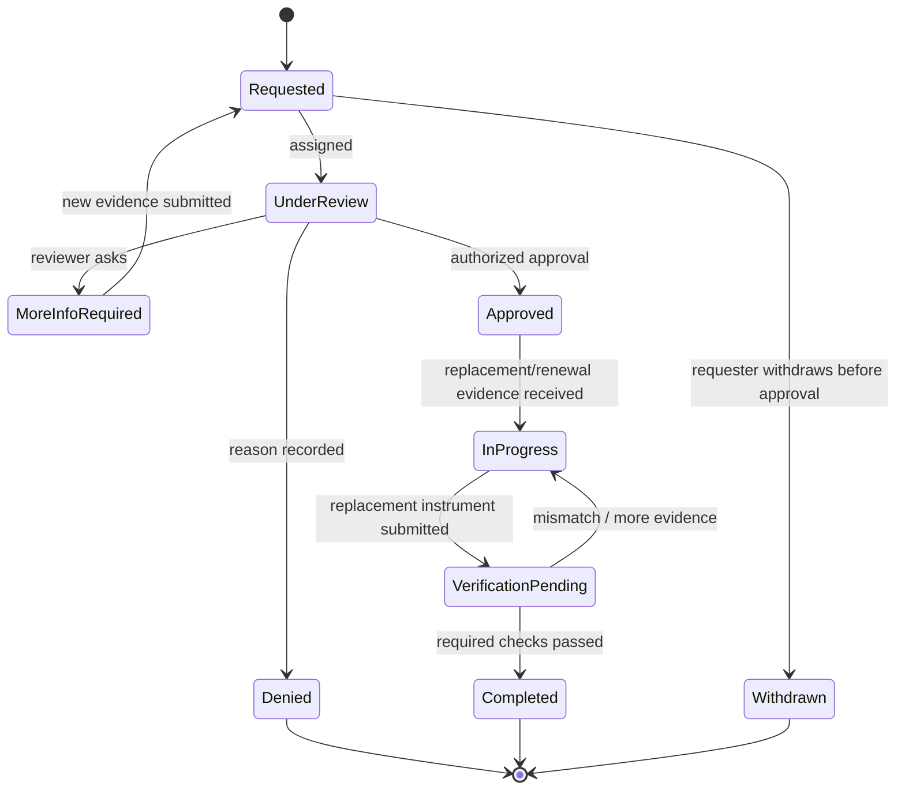
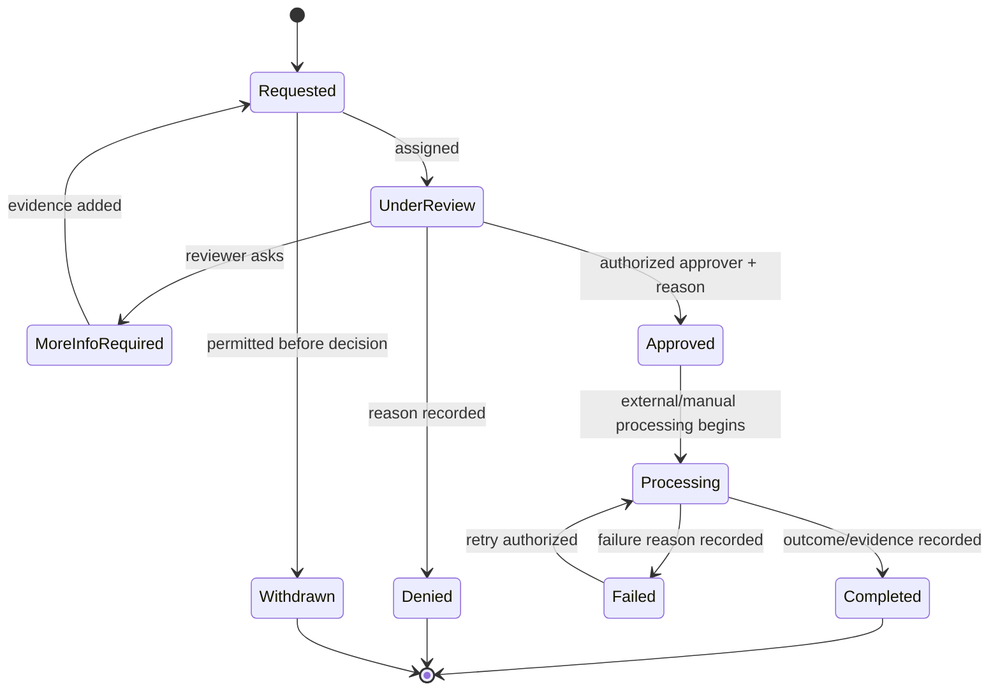

# DepositGuard AI — Architecture and Delivery Blueprint

**Context:** Smart India Hackathon 2026 · AICTE PS 26265 — Streamline of Security Deposit/FDR Portal  
**Status:** Pre-implementation design; no application code is included.  
**Design stance:** Modular monolith with explicit trust boundaries, configurable policy, and adapters for external capabilities.

## 1. Scope and design principles

DepositGuard manages institution-owned financial instruments and their supporting documents. It coordinates data entry, extraction, comparison, review, verification, maturity/validity follow-up, renewal/replacement, and release/refund requests. It is a workflow and record-keeping system; it does not itself establish that a bank, regulator, or institution has authenticated a fact.

Core principles:

- Resolve the authenticated user, active role, and authorized institution scope from trusted server-side identity and membership records. Never accept these as authority from a request body.
- Enforce institution scoping in every database query and every object-storage access path. Deny by default.
- Keep submitted values, OCR observations, reviewer decisions, bank-adapter results, and derived alerts as separate records with provenance.
- A demo bank adapter must identify every result as simulated. A simulated match is never evidence of genuine bank verification.
- Keep legal, regulatory, and operational thresholds configurable. Defaults are explicitly marked as demo assumptions pending approval.
- Use private object storage, short-lived authorized download links, and audited access. Do not store document bytes in public web assets.

## 2. Architecture diagram



### Logical module boundaries

Each module owns its routes, input/output schemas, domain service, persistence access, and tests. Modules call one another through services, not by reaching into another module's collections.

1. **Identity & institutions:** users, institution memberships, roles, invitations and account state.
2. **Instruments:** FDR records and instrument-level lifecycle facts.
3. **Documents:** upload intents, private objects, OCR jobs/results and retention state.
4. **Comparison & review:** submitted/extracted field comparisons, discrepancy cases and reviewer decisions.
5. **Verification:** bank adapter requests/results, idempotency and retries.
6. **Lifecycle workflows:** maturity/validity alerts, renewal/replacement, release/refund.
7. **Reporting & notifications:** scoped reports, alert delivery and export jobs.
8. **Audit & platform:** audit events, configuration, health, observability and scheduled jobs.

## 3. Data-flow diagrams

### Instrument intake, extraction and review

```mermaid
sequenceDiagram
  actor User
  participant UI as React UI
  participant API as Express API
  participant Guard as AuthZ + institution scope
  participant Doc as Document service
  participant Store as Private storage
  participant OCR as OCR adapter
  participant DB as MongoDB
  participant Review as Review service
  User->>UI: Enter instrument data / request upload
  UI->>API: Create instrument or upload intent
  API->>Guard: Resolve identity, membership and permitted institution
  Guard-->>API: Trusted actor + institution scope
  API->>DB: Validate and persist submitted fields (versioned)
  API->>Doc: Create constrained upload intent
  Doc->>Store: Issue short-lived upload capability for private object
  User->>Store: Upload document bytes
  UI->>API: Complete upload and request extraction
  API->>Doc: Verify object metadata; queue OCR
  Doc->>OCR: Extract content from authorized object
  OCR-->>Doc: OCR observations + confidence + provider metadata
  Doc->>DB: Persist immutable OCR result, separate from submitted data
  API->>Review: Compute field comparison and open/update discrepancy case
  Review->>DB: Persist comparison snapshot and review state
  Review->>DB: Append audit event
  Review-->>UI: Submitted vs extracted vs reviewed values with provenance
```

### Verification and privileged decisions

```mermaid
sequenceDiagram
  actor Reviewer
  participant API as Express API
  participant Policy as RBAC / scope / transition guard
  participant Workflow as Workflow service
  participant Bank as Bank adapter
  participant DB as MongoDB
  participant Audit as Audit service
  Reviewer->>API: Request bank verification / decide review / approve release
  API->>Policy: Authenticate, authorize action, verify institution scope and current version
  Policy-->>API: Allow or deny
  API->>Workflow: Execute allowed command with idempotency key
  Workflow->>Bank: Request verification
  Bank-->>Workflow: Result + adapter name + simulated flag + timestamp
  Workflow->>DB: Store verification result separately; do not overwrite review decision
  Workflow->>Audit: Append actor, action, target, reason, before/after references
  Audit->>DB: Persist event
  Workflow-->>API: Current state and provenance
```

## 4. Project folder structure

```text
depositguard-ai/
├── apps/
│   ├── web/                         # React/Vite/TS; feature-oriented UI
│   │   └── src/
│   │       ├── app/                 # Router, providers, authenticated shell
│   │       ├── components/          # Shared UI; shadcn/ui primitives
│   │       ├── features/            # instruments, documents, review, workflows
│   │       ├── lib/                 # API client, auth context, formatting
│   │       └── styles/
│   └── api/                         # Express/TS modular monolith
│       └── src/
│           ├── config/              # Env parsing, runtime configuration
│           ├── middleware/          # Auth, scope, validation, errors, rate limits
│           ├── modules/
│           │   ├── identity/        # routes, schemas, controller, service, model
│           │   ├── institutions/
│           │   ├── instruments/
│           │   ├── documents/
│           │   ├── review/
│           │   ├── verification/
│           │   ├── workflows/
│           │   ├── alerts/
│           │   ├── reports/
│           │   └── audit/
│           ├── adapters/            # storage, OCR, bank, email, clock
│           ├── jobs/                # scheduled work and queue handlers
│           ├── shared/              # errors, IDs, pagination, redaction
│           └── server.ts
├── packages/
│   └── contracts/                   # Shared API DTOs and Zod schemas (no secrets)
├── docs/                            # architecture, ADRs, operational runbooks
├── infra/                           # deployment definitions; secrets referenced only
├── .env.example                     # names and safe placeholders only
└── package.json                     # workspace scripts
```

## 5. Database collection designs

All primary documents include `createdAt`, `updatedAt`, and schema/version metadata. Use MongoDB Atlas with backups, TLS, least-privilege database credentials, and replica-set transactions where multi-document state changes require atomicity. Every institution-owned record includes immutable `institutionId`. Use compound indexes beginning with `institutionId` for scoped queries. Use soft deletion only where policy requires it; preserve audit history.

| Collection            | Key fields                                                                                                                                                                                                                                                         | Indexes / invariants                                                                                                                                                                |
| --------------------- | ------------------------------------------------------------------------------------------------------------------------------------------------------------------------------------------------------------------------------------------------------------------ | ----------------------------------------------------------------------------------------------------------------------------------------------------------------------------------- |
| `users`               | `_id`, `emailNormalized`, `displayName`, `authSubject`, `status`, `createdAt`                                                                                                                                                                                      | Unique `authSubject`; unique normalized email if local identity policy requires it. No client-set role.                                                                             |
| `institutions`        | `_id`, `name`, `externalRef`, `status`, `configRef`                                                                                                                                                                                                                | Unique approved external reference; avoid relying on mutable display name for identity.                                                                                             |
| `memberships`         | `_id`, `userId`, `institutionId`, `role`, `status`, `grantedBy`, `validFrom`, `validUntil`                                                                                                                                                                         | Unique active membership tuple; query by `(userId,status)` and `(institutionId,status,role)`. Role changes audited.                                                                 |
| `instruments`         | `_id`, `institutionId`, `instrumentType`, `bankName`, `branch`, `accountRefEncrypted/tokenized`, `fdrNumberEncrypted/indexHash`, `holderName`, `principal`, `currency`, `issueDate`, `maturityDate`, `validUntil`, `currentLifecycleState`, `version`, `createdBy` | `(institutionId,currentLifecycleState,maturityDate)`; unique scoped blind index for instrument identity if approved. Encrypt/tokenize sensitive references; avoid plaintext search. |
| `instrumentRevisions` | `_id`, `institutionId`, `instrumentId`, `revision`, `submittedFields`, `actorId`, `reason`, `createdAt`                                                                                                                                                            | Unique `(instrumentId,revision)`; append-only snapshots preserve submitted values.                                                                                                  |
| `documents`           | `_id`, `institutionId`, `instrumentId`, `objectKey`, `contentType`, `size`, `sha256`, `classification`, `uploadedBy`, `scanStatus`, `retentionState`                                                                                                               | `(institutionId,instrumentId,createdAt)`; unique object key. Private bucket; never expose raw object key to unauthorized clients.                                                   |
| `ocrResults`          | `_id`, `institutionId`, `documentId`, `provider`, `providerVersion`, `status`, `fields[] {name,value,confidence,page,bbox}`, `rawResultRef`, `completedAt`                                                                                                         | `(institutionId,documentId,createdAt)`; immutable result snapshots; raw OCR payload separately protected and retained only as needed.                                               |
| `comparisons`         | `_id`, `institutionId`, `instrumentId`, `submittedRevision`, `ocrResultId`, `fieldResults[] {field,submitted,extracted,normalized,matchState}`, `ruleVersion`, `createdAt`                                                                                         | `(institutionId,instrumentId,createdAt)`; deterministic comparison snapshot; no implicit acceptance of OCR.                                                                         |
| `discrepancies`       | `_id`, `institutionId`, `instrumentId`, `comparisonId`, `field`, `state`, `severity`, `assignedTo`, `resolution`, `resolvedBy`, `resolvedAt`, `version`                                                                                                            | `(institutionId,state,severity,createdAt)`; resolution reason required; reopen history in events.                                                                                   |
| `reviewDecisions`     | `_id`, `institutionId`, `instrumentId`, `decision`, `reason`, `reviewerId`, `basedOnRevision`, `basedOnComparisonId`, `createdAt`                                                                                                                                  | `(institutionId,instrumentId,createdAt)`; append-only; decision cannot mutate OCR/bank results.                                                                                     |
| `bankVerifications`   | `_id`, `institutionId`, `instrumentId`, `adapter`, `mode` (`SIMULATED`/`LIVE`), `requestId`, `status`, `responseCode`, `matchedFields`, `evidenceRef`, `requestedBy`, `requestedAt`, `completedAt`                                                                 | Unique `(adapter,requestId)`; `(institutionId,instrumentId,createdAt)`. Demo response always carries simulation marker and explanatory UI text.                                     |
| `workflowCases`       | `_id`, `institutionId`, `instrumentId`, `kind` (`RENEWAL`/`REPLACEMENT`/`RELEASE_REFUND`), `state`, `requestedBy`, `assignedTo`, `payload`, `reason`, `version`, `openedAt`, `closedAt`                                                                            | `(institutionId,kind,state,openedAt)`; all transitions recorded separately.                                                                                                         |
| `workflowEvents`      | `_id`, `institutionId`, `caseId`, `fromState`, `toState`, `action`, `actorId`, `reason`, `createdAt`, `idempotencyKey`                                                                                                                                             | Unique `(caseId,idempotencyKey)` where supplied; append-only.                                                                                                                       |
| `alerts`              | `_id`, `institutionId`, `instrumentId`, `ruleId`, `ruleVersion`, `triggerDate`, `kind`, `state`, `recipientIds[]`, `deliveryRefs[]`                                                                                                                                | Unique dedupe key `(instrumentId,ruleId,triggerDate)`; generated from configurable rules.                                                                                           |
| `auditEvents`         | `_id`, `occurredAt`, `actorId`, `actorRoleSnapshot`, `institutionId`, `action`, `targetType`, `targetId`, `requestId`, `reason`, `beforeHash`, `afterHash`, `metadataRedacted`, `source`                                                                           | `(institutionId,occurredAt)`, `(targetType,targetId,occurredAt)`, `(actorId,occurredAt)`; append-only permissions and export controls.                                              |
| `ruleConfigurations`  | `_id`, `scope`, `institutionId?`, `ruleKey`, `value`, `unit`, `effectiveFrom`, `effectiveTo`, `version`, `approvedBy`, `assumptionLabel`                                                                                                                           | Unique effective version by scope/key; never activate guessed legal rules without designated approval.                                                                              |
| `idempotencyRecords`  | `_id`, `institutionId`, `actorId`, `key`, `route`, `requestHash`, `responseRef`, `expiresAt`                                                                                                                                                                       | TTL for bounded retention; unique `(institutionId,actorId,key,route)`.                                                                                                              |

Sensitive document contents belong in private object storage, not MongoDB. Decide whether FDR/account identifiers need encryption, tokenization, blind indexes, or masking before implementation. Mongoose middleware alone is not a security boundary: services/repositories must require an institution scope and include it in every query/update/delete.

## 6. API endpoint specifications

**Conventions:** `/api/v1`; JSON; Zod validation at boundaries; authenticated identity resolved by server middleware. Every institution-owned endpoint derives scope from membership. A path institution ID, if used, is only a requested target and must be checked against that membership. Use cursor pagination, bounded page sizes, `ETag`/version or `If-Match` for mutable records, idempotency keys for retries, consistent problem details, and request IDs. Never accept `role`, `actorId`, trusted `institutionId`, or workflow `state` as authoritative command fields.

| Method + path                                                               | Purpose / authorization                                              | Request and important response                                                                                                 |
| --------------------------------------------------------------------------- | -------------------------------------------------------------------- | ------------------------------------------------------------------------------------------------------------------------------ |
| `GET /me`                                                                   | Any authenticated user; own identity and authorized memberships      | Returns roles/scopes from server-side records.                                                                                 |
| `GET /institutions`                                                         | Authenticated member; only institutions accessible to caller         | Cursor page of permitted institutions.                                                                                         |
| `GET /institutions/:institutionId/summary`                                  | Institution-scoped viewer                                            | Counts and maturity summary using active config version.                                                                       |
| `GET /institutions/:institutionId/instruments`                              | Institution member with read permission                              | Filters, cursor page, redacted identifiers.                                                                                    |
| `POST /institutions/:institutionId/instruments`                             | Institution contributor                                              | Validated manual fields; server binds institution and creator; returns instrument + version.                                   |
| `GET /institutions/:institutionId/instruments/:instrumentId`                | Scoped reader                                                        | Instrument, revision pointer, lifecycle and provenance summaries.                                                              |
| `PATCH /institutions/:institutionId/instruments/:instrumentId`              | Contributor; restricted fields and state-aware guard                 | Allowed field patch, reason, expected version; creates revision.                                                               |
| `GET /institutions/:institutionId/instruments/:instrumentId/history`        | Scoped reader; sensitive-field redaction                             | Revisions, workflow events, decisions, verification history.                                                                   |
| `POST /institutions/:institutionId/documents/upload-intents`                | Contributor                                                          | Instrument ID, document purpose, declared type/size; returns short-lived private upload URL and intent ID.                     |
| `POST /institutions/:institutionId/documents/:documentId/complete`          | Uploader or scoped manager                                           | Confirms upload; server checks object existence, size, checksum/type and scan status.                                          |
| `POST /institutions/:institutionId/documents/:documentId/extractions`       | Contributor/reviewer per policy                                      | Queues OCR; returns job ID, never claims extraction is verified.                                                               |
| `GET /institutions/:institutionId/documents/:documentId`                    | Scoped reader with document permission                               | Metadata and extraction status.                                                                                                |
| `POST /institutions/:institutionId/documents/:documentId/download-intent`   | Scoped reader with explicit document access                          | Returns short-lived authorized URL; logs access.                                                                               |
| `GET /institutions/:institutionId/instruments/:instrumentId/comparisons`    | Scoped reader                                                        | Submitted vs OCR values, confidence, comparison rule version.                                                                  |
| `POST /institutions/:institutionId/instruments/:instrumentId/reviews`       | Official reviewer                                                    | Decision (`ACCEPT`, `RETURN`, `REJECT` per approved vocabulary), reason, based-on versions; server appends decision and audit. |
| `POST /institutions/:institutionId/discrepancies/:id/resolution`            | Authorized reviewer                                                  | Resolution action/reason/expected version; server controls state transition.                                                   |
| `POST /institutions/:institutionId/instruments/:instrumentId/verifications` | Authorized reviewer                                                  | Explicit request plus idempotency key; no user-supplied adapter result. Demo adapter response is `SIMULATED`.                  |
| `GET /institutions/:institutionId/instruments/:instrumentId/verifications`  | Scoped reader                                                        | Historical results; prominent mode/status/provenance fields.                                                                   |
| `POST /institutions/:institutionId/instruments/:instrumentId/workflows`     | Contributor for eligible workflow request                            | `kind`, reason and request payload; initial state assigned by server.                                                          |
| `POST /institutions/:institutionId/workflows/:caseId/actions`               | Role/policy-specific reviewer or approver                            | Action and reason, expected version, idempotency key; never a target state.                                                    |
| `GET /institutions/:institutionId/workflows`                                | Scoped reader                                                        | Filtered cases with state and history summary.                                                                                 |
| `GET /institutions/:institutionId/alerts`                                   | Scoped reader                                                        | Active/dismissed alerts and rule provenance.                                                                                   |
| `GET /institutions/:institutionId/reports/:reportType`                      | Permission-specific report reader                                    | Validated filters, redacted output or export job ID.                                                                           |
| `GET /institutions/:institutionId/audit-events`                             | Institution auditor/authorized reviewer                              | Cursor-paged, redacted audit events; no update/delete endpoint.                                                                |
| `GET /admin/rules` / `PUT /admin/rules/:ruleKey`                            | System/rule administrator with elevated grant                        | Read/version configuration; change requires reason, approval policy and audit.                                                 |
| `GET /health/live` / `GET /health/ready`                                    | Liveness public/internal; readiness protected as deployment requires | No credentials, tenant data, or infrastructure secrets in response.                                                            |

**Error semantics:** `400` malformed schema; `401` unauthenticated; `403` authenticated but unauthorized; `404` for inaccessible object where existence disclosure is a concern; `409` stale version/invalid transition/idempotency conflict; `413` upload limit; `422` semantic validation; `429` rate-limited. Avoid returning whether a foreign institution's object exists.

## 7. Role-permission matrix

Roles are scoped by membership, not globally trusted request claims. Exact role names and assignment authority require stakeholder confirmation. Proposed least-privilege starting point:

| Capability                                |     Institution Viewer | Institution Contributor |                         Official Reviewer |             Institution Admin |                        System Admin |
| ----------------------------------------- | ---------------------: | ----------------------: | ----------------------------------------: | ----------------------------: | ----------------------------------: |
| View scoped instruments and dashboard     |                    Yes |                     Yes |                            Assigned scope |                           Yes |               Operational need only |
| Create/update submitted instrument fields |                     No |                     Yes |                    No (avoid self-review) | Yes, if separately authorized |                   No routine access |
| Upload/view/download scoped documents     |        View if granted |                     Yes |                           Yes if assigned |                           Yes |           Break-glass only, audited |
| Request OCR / view comparison             |                   View |                 Request |                                       Yes |                           Yes |                   No routine access |
| Resolve discrepancies / official review   |                     No |                      No |                       Yes, assigned scope |                 No by default |                                  No |
| Request simulated/live bank check         |                     No |   Possibly request only |                                       Yes |          Configure permission |              Configure adapter only |
| Request renewal/replacement/release       |                     No |                     Yes |                 Request if policy permits |                           Yes |                                  No |
| Approve/deny release/refund               |                     No |                      No | Authorized approver, separation-of-duties |                 No by default |                                  No |
| Manage memberships in own institution     |                     No |                      No |                                        No |        Yes, constrained roles |     Global identity operations only |
| Change institution rules                  |                     No |                      No |                            Recommend only |                  Propose only | Designated rule admin with approval |
| Read audit history                        | Own actions if exposed |         Scoped, limited |                      Assigned institution |               Own institution |        Security operations, audited |
| Export reports                            |          No or limited |      Scoped operational |                           Scoped official |                        Scoped |       No routine tenant-wide export |

Authorization should be expressed as capability checks over `(actor, action, resource, institution scope, assignment, state)` rather than scattered role-name comparisons. For critical actions, enforce separation of duties (requester cannot approve their own request) if stakeholders confirm this policy.

## 8. Workflow state machines

States below are proposed implementation vocabulary, not AICTE requirements. They must be confirmed with process owners. Persist each transition as an event and perform a server-side transition guard with optimistic concurrency.

### FDR record/review



OCR failure must not silently become acceptance. Keep the OCR job state (`QUEUED`, `RUNNING`, `SUCCEEDED`, `FAILED`, `CANCELLED`) independent from official review state.

### Renewal / replacement case



### Release / refund case



“Completed” records the portal workflow outcome only. It must not imply a bank transfer or refund occurred unless corroborated by an approved evidence source and vocabulary.

### Bank verification adapter result

```text
NOT_REQUESTED -> QUEUED -> RUNNING -> (MATCH | MISMATCH | INCONCLUSIVE | UNAVAILABLE | ERROR)
```

Every result also contains `mode=SIMULATED|LIVE`, adapter identity, timestamps, and evidence/provenance. Demo mode only produces deterministic simulated results and UI/API labels such as “Simulated demo response — not bank verified.” No status transition from simulated to live by editing the result; a separate request and record are required.

## 9. Threat model and security checklist

### Assets and trust boundaries

- Personally or institutionally sensitive instrument identifiers, balances, names, dates, and scanned documents.
- Review and release/refund decisions; audit records; user credentials/tokens; storage credentials and provider keys.
- Boundaries: browser ↔ API; identity provider ↔ API; one institution ↔ another; API ↔ MongoDB; API ↔ object storage; API ↔ OCR/bank/email providers; scheduled jobs ↔ persisted work.

### Threats and controls

| Threat                                                                | Required control                                                                                                                                                                         |
| --------------------------------------------------------------------- | ---------------------------------------------------------------------------------------------------------------------------------------------------------------------------------------- |
| Cross-institution IDOR / confused deputy                              | Derive actor and memberships server-side; scope every query and storage key; authorize object, action, and state; negative tests for foreign IDs.                                        |
| Client forges role, institution, reviewer, status, OCR or bank result | Ignore/reject authority-bearing fields; only server transition commands; adapter owns result fields; immutable provenance records.                                                       |
| Credential theft / session abuse                                      | Established OIDC provider where available, secure cookies or rigorously managed tokens, MFA for privileged roles, short sessions, revocation, CSRF protection where cookie auth is used. |
| Malicious upload / malware / parser exploit                           | Allowlist content types and sizes; verify signature not just extension; quarantine; malware scan; random object keys; no inline execution; OCR in isolated worker with resource limits.  |
| Private document URL leakage                                          | Private bucket, short expiration, narrow object/method capability, no public ACL, access audit, no URLs in logs/analytics.                                                               |
| OCR prompt/content injection or false extraction                      | Treat document text as untrusted data; OCR is observation only; confidence and page references; human review; no executable instructions or auto-approval.                               |
| SSRF through URLs or provider configuration                           | Do not accept arbitrary fetch URLs; outbound allowlist; safe DNS/IP validation; fixed provider endpoints; restrict egress.                                                               |
| Workflow race / replay / duplicate action                             | Version preconditions; idempotency keys; database transaction where needed; unique indexes; transition guard; audit outcome.                                                             |
| Privileged insider / self-approval                                    | Least privilege, assignment scope, separation of duties, reason capture, periodic membership review, immutable audit and alerting.                                                       |
| Sensitive data in logs/reports                                        | Structured logging with redaction; mask identifiers; scoped report queries; export authorization, expiry and access log; avoid dumping request bodies.                                   |
| NoSQL injection / mass assignment                                     | Zod allowlisted DTOs; never pass request objects directly to Mongoose; fixed query operators; escape search; Mongoose strict schemas.                                                    |
| XSS / CSRF / clickjacking                                             | Output encoding; CSP; secure headers; CSRF defenses for cookie sessions; same-site policy; dependency hygiene.                                                                           |
| Enumeration / denial of service                                       | Rate limits, bounded pagination, upload quotas, queue limits, generic inaccessible-object errors, monitoring and abuse controls.                                                         |
| Secret exposure / supply chain                                        | Environment/secret manager; least-privilege credentials; rotation; `.env` ignored; lockfiles, dependency scanning, pinned CI actions; no secrets in images or logs.                      |
| Audit tampering / repudiation                                         | Append-only application permissions, immutable backups/retention where feasible, actor and request correlation, hash chaining or external tamper-evident sink if required.               |
| Alert duplication / incorrect rules                                   | Versioned, approved configurable rules; dedupe keys; time-zone definition; dry-run and explainable calculation; no invented regulatory threshold.                                        |

### Release checklist

- [ ] Authentication provider, session/token model, MFA policy and user lifecycle approved.
- [ ] Every endpoint has an explicit capability and institution scope check; foreign tenant access denied without disclosing existence.
- [ ] Server derives actor, memberships, role, reviewer assignment, and workflow transitions; request fields cannot override them.
- [ ] Data classification, encryption in transit/at rest, key management, identifier masking and retention/deletion rules approved.
- [ ] Upload limits, quarantine, antivirus, content sniffing, private bucket policies and signed URL expiration configured.
- [ ] OCR provider's data residency, retention, training use, security and failure behavior reviewed; demo/local adapter identified.
- [ ] Bank adapter demo mode is visibly and machine-readably simulated; no copy claims genuine verification; live integration requires separate approval and credentials.
- [ ] Rule thresholds, time-zone/calendar semantics and reviewer vocabularies are approved, versioned and auditable.
- [ ] Audit event coverage includes authentication-sensitive actions, data changes, document access, decisions, exports, membership/config changes and failures.
- [ ] Concurrency, idempotency, retry and transaction behavior defined for each workflow command.
- [ ] Secrets externalized; production CORS/CSP/headers/rate limits/monitoring/backups/restore drill set.
- [ ] Accessibility, responsive layouts, supported browsers and localization/date/currency policy agreed.
- [ ] Security review includes tenant-isolation, authorization bypass, malicious file, replay and privilege escalation cases.

## 10. Ambiguities and decisions required

These are implementation-blocking or materially security-sensitive. Proposed defaults are only for a hackathon demo and must be labeled as assumptions until confirmed.

| Topic                                     | What is unclear                                                                                                                        | Safe provisional assumption / decision needed                                                                                                               |
| ----------------------------------------- | -------------------------------------------------------------------------------------------------------------------------------------- | ----------------------------------------------------------------------------------------------------------------------------------------------------------- |
| User identity and institution onboarding  | Who authenticates users, validates institution identity, and grants the first administrator?                                           | Use an established OIDC identity provider; institution membership is provisioned by a trusted admin. Confirm actual provider and onboarding authority.      |
| Role definitions and scope                | Exact official roles, delegation, assignments, and whether roles span multiple institutions                                            | Use the least-privilege roles in §7, institution-scoped memberships, and deny unspecified actions. Confirm role names and assignment model.                 |
| Approval authority / separation of duties | Who can accept an FDR or approve release/refund; can a requester approve their own case?                                               | Require a distinct authorized approver for release/refund in demo; confirm official delegation and quorum requirements.                                     |
| Meaning of “FDR management”               | Required instruments, fields, currencies, joint holders, lien/beneficiary data, partial releases, and multiple instruments per deposit | Store configurable instrument fields and preserve revisions; confirm data dictionary and allowed document types.                                            |
| Verification reality                      | Whether any real bank API/endpoint, consent, legal basis, bank list or credentials exist                                               | Demo adapter only; deterministic synthetic outcomes with persistent `SIMULATED` tag. Confirm future live integration and evidence standard separately.      |
| OCR provider and data handling            | Provider, supported languages/scripts, retention, residency, accuracy threshold and human correction path                              | Adapter interface; no automatic acceptance; use synthetic/non-sensitive demo documents until provider and privacy review are complete.                      |
| Review semantics                          | Meaning of accept/return/reject; whether OCR discrepancy blocks review; appeals/reopening                                              | Proposed states in §8; discrepancy never auto-resolves; confirm decision vocabulary and reopening authority.                                                |
| Maturity/validity rules                   | Which date governs reminders, lead times, grace periods, holidays, time zones and escalation schedule                                  | Configurable, versioned rules with clearly labeled demo assumptions. Do not encode guessed AICTE rules. Confirm source/owner of each rule.                  |
| Renewal/replacement semantics             | Whether renewal creates a linked new instrument, replaces the prior one, and what continuity/overlap is required                       | New instrument linked through workflow; old record retained and marked superseded only after approved completion. Confirm linkage and eligibility.          |
| Release/refund evidence                   | What “release” means, required authorizations/evidence, who records actual payment, and external processing integration                | Portal records request and review only; “completed” means recorded workflow evidence, not proof of transfer absent accepted evidence. Confirm requirements. |
| Document retention and privacy            | Retention period, deletion/legal hold, data residency, access/export rights and breach process                                         | Private storage; configurable retention policy; do not choose a legal period without owner approval. Confirm applicable policies.                           |
| Audit requirements                        | Required fields, retention, export, tamper evidence and who can inspect records                                                        | Append-only events and scoped read access; confirm formal retention and audit evidence requirements.                                                        |
| Notifications and reports                 | Channels, recipients, escalation, delivery guarantees, report formats and permitted exports                                            | In-app alerts first; email adapter optional; reports scoped and redacted. Confirm channels and operational ownership.                                       |
| Scale and availability                    | Concurrent institutions, instruments/documents, expected OCR volume, RPO/RTO, uptime target                                            | Hackathon-scale modular monolith and asynchronous OCR/job interfaces; confirm expected production targets.                                                  |
| Deployment and operations                 | Hosting region, network model, CI/CD, backup owner, incident response and environment separation                                       | Separate demo/staging/production config; secrets managed by platform. Confirm hosting and operational owner.                                                |

## 11. Ordered implementation plan and acceptance criteria

No application implementation is started by this blueprint. The following sequence creates reviewable increments.

| Order | Work package                                             | Acceptance criteria                                                                                                                                                                                                                   |
| ----- | -------------------------------------------------------- | ------------------------------------------------------------------------------------------------------------------------------------------------------------------------------------------------------------------------------------- |
| 0     | Resolve policy, identity, privacy and workflow questions | Named owners approve role map, institution onboarding, field dictionary, lifecycle vocabulary, release authority, retention, time-zone and configurable rules; unresolved legal rules remain explicitly unimplemented.                |
| 1     | Repository, runtime configuration and CI skeleton        | React/Vite/TS and Express/TS run independently in a workspace; Zod validates all environment variables at startup; `.env.example` contains placeholders only; lint/typecheck/build scripts are repeatable.                            |
| 2     | Shared contracts and API boundary                        | Versioned DTO schemas; consistent errors/request IDs; security headers, CORS allowlist, rate limits and redacted logs; health endpoints reveal no secrets.                                                                            |
| 3     | Authentication, memberships and tenant isolation         | Server resolves user and memberships; all institution data access requires scope; cross-institution reads/writes return safe denial; no request role or tenant ID grants access.                                                      |
| 4     | Persistence and audit foundation                         | Mongoose models/indexes and migrations/seed strategy documented; scoped repository methods; audit event appended atomically or failure behavior is explicit; audit records cannot be edited through API.                              |
| 5     | Instrument entry and revision history                    | Manual instrument creation/edit validates fields, records revision/reason/actor, uses concurrency token, masks sensitive identifiers, and preserves prior versions.                                                                   |
| 6     | Private documents and OCR adapter                        | Upload uses size/type constraints, quarantine/scan state, private storage, expiring scoped access; OCR persists separate observations with provider/confidence; errors and retries are visible.                                       |
| 7     | Comparison and official review                           | Comparison references exact submitted revision and OCR result; discrepancy resolution and review require authorized reviewer, reason, and version; OCR cannot set official decision.                                                  |
| 8     | Simulated bank verification                              | Deterministic fixtures keyed by safe synthetic test inputs; every response and UI states simulated; adapter is replaceable; no wording implies genuine bank verification.                                                             |
| 9     | Renewal/replacement and release/refund workflows         | Server-enforced transition tables, idempotency, event history, requester/approver separation if confirmed, and clear evidence semantics; no client-provided target state accepted.                                                    |
| 10    | Maturity monitoring, notifications and reports           | Versioned rules with provenance, deduplicated alerts, explicit time-zone policy, scoped report filters, redaction, and export auditing.                                                                                               |
| 11    | Responsive UI and accessibility pass                     | Role-aware navigation, keyboard access, visible status/provenance labels, responsive layouts, loading/error/empty states, and accessible forms verified at agreed viewport/browser matrix.                                            |
| 12    | Security and operational readiness                       | Tenant-isolation and workflow authorization review passes; dependency and secret scans clean or triaged; backup/restore, monitoring, alerting and incident runbooks approved; production launch remains gated on stakeholder signoff. |

## 12. Proposed demo assumptions (must be visibly labeled)

1. Single reviewer decision is sufficient for routine record review; release/refund approval may use a separate approver role pending confirmation.
2. Demo institution, users, instruments, documents and bank results are synthetic.
3. Simulated bank results are deterministic fixtures and never call a bank.
4. OCR output is advisory and human review is required for acceptance.
5. Reminder lead times, if shown, are demonstration configuration values, not AICTE rules.
6. The modular monolith uses asynchronous adapter/job interfaces so OCR, storage, notifications and bank verification can later be replaced without changing domain workflow semantics.
